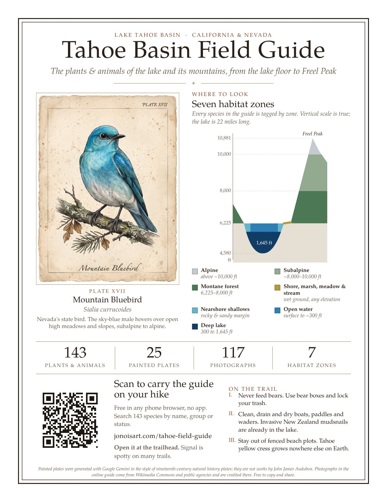

# Tahoe Basin Field Guide

[](flyer/Tahoe-Basin-Field-Guide-flyer.pdf)

**[Open the guide](https://jonoisart.github.io/tahoe-field-guide/)** · **[Download the printable flyer (PDF, US Letter)](flyer/Tahoe-Basin-Field-Guide-flyer.pdf)**

A searchable field guide to 143 plants and animals of Lake Tahoe and its watershed, from the lake floor (4,580 ft) to Freel Peak (10,881 ft). Each entry gives its habitat zone, status (native, endemic, protected, introduced, invasive), a short natural-history note, a Wikipedia link and an image.

A one-page printable flyer with a QR code lives in `flyer/`.

Planned home: **jonoisart.com/tahoe-field-guide**

## Layout

| Path | What it is |
|---|---|
| `index.html` | Standalone page for static hosting. Generated, don't edit by hand |
| `src/tahoe-field-guide.html` | Source of truth: the page as published on claude.ai (a fragment, no `<html>`/`<head>`) |
| `img/` | 25 painted plates, scaled to 1,400 px long edge, never cropped |
| `thumbs/` | 117 photo thumbnails (plus one superseded by a plate) (≤320 px) from Wikimedia Commons and US agencies |
| `data/thumbs-data.json` | Credit and license for every thumbnail |
| `scripts/build_index.py` | Wraps `src/` into `index.html` |
| `scripts/thumbs_inject.py` | Merges a thumbnail manifest into the data and the page |
| `flyer/` | Flyer build script, QR generator, `qr.svg`, and the PDF |

## Update workflow

```sh
# after editing src/tahoe-field-guide.html
python3 scripts/build_index.py

# add or replace thumbnails from a manifest (copy the JPEGs into thumbs/ first)
python3 scripts/thumbs_inject.py path/to/manifest.json
python3 scripts/build_index.py

# rebuild the flyer (needs Playwright + Chromium; QR needs reportlab + opencv-python)
python3 flyer/make_qr.py https://jonoisart.com/tahoe-field-guide
python3 flyer/build.py   # writes flyer/flyer.html; print it to PDF at 8.5x11 in, no margins
```

## Hosting

Any static host works. Point the host's root at this repo (GitHub Pages: Settings → Pages → deploy from `main`, root; Cloudflare Pages: no build command, output directory `/`).

## Credits and licensing

- **Plates** were generated with Google Gemini in the style of nineteenth-century natural history plates. They are not works by John James Audubon and were not painted from specimens. The plate number and name in each caption are authoritative; text printed inside a painting may be wrong.
- **Photographs** come from Wikimedia Commons contributors and US federal agencies. Each keeps its own license (CC0, public domain, CC BY, CC BY-SA), recorded in `data/thumbs-data.json` and credited on its entry. CC BY-SA images stay under CC BY-SA.
- **Code and text** are MIT licensed (see `LICENSE`).
- Natural-history facts were compiled from UC Davis TERC, the USDA Forest Service Lake Tahoe Basin Management Unit, TRPA, Nevada DCNR and USFWS. Confirm legal status with the agency before relying on it.
